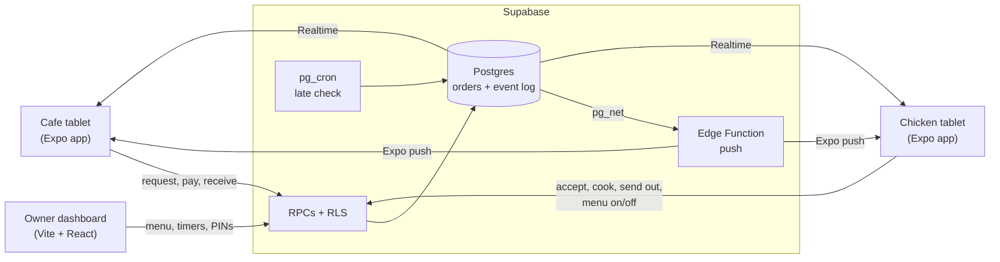

&nbsp;&nbsp;&nbsp;&nbsp;

# Cluck & Cup

**An order relay between two stores: But First, Coffee and Urban StrEat**

[The problem](#the-problem) · [Our solution](#our-solution) · [Results](#results) · [Tech stack](#tech-stack) · [How it works](#how-it-works) · [Team](#team)

> [!NOTE]
> Cluck & Cup is an academic project for **CSSWENG (Software Engineering)** at De La Salle University, built in 2026 by a team of eight for a real client. The source code lives in a private repository. This repository describes the project; the code is available on request.

## The problem

But First, Coffee and Urban StrEat share an owner and sit about a kilometre apart. Cafe customers often want chicken from Urban StrEat, so the cafe cashier types the order into Messenger. Someone at Urban StrEat has to notice that message, retype it into their own POS and reply by hand.

On a busy Saturday night the chicken staff are working the counter and miss the message. The customer was promised 30 to 40 minutes, and by the time anyone notices, the order is already late. The client named this as the biggest cause of delays, especially on weekends from 6 pm onwards.

There were smaller problems too:

- **No order numbers**, so several orders at once were hard to tell apart.
- **No status**: the only way to know whether an order was cooking or on its way was to message back and forth.
- **No payment trail**: if a payment was questioned later, nothing tied it to a specific order.

## Our solution

Cluck & Cup runs on the Android tablets both stores already have and connects them, so orders pass between the stores automatically.

- **Orders get noticed.** The chicken tablet sounds a loud alert the moment an order arrives. Staff accept it, decline it, or lower the quantity when stock is low, and the cafe sees the answer straight away. An order that sits too long at any step is flagged as late, so no one has to keep checking.
- **Every order is tracked.** Each order has its own number, and both tablets show where it is: waiting for a response, ready to pay, cooking, on the way, or received.
- **Payments are recorded.** The cashier records whether the customer paid with GCash or cash, and that is saved with the order along with a log of every step.
- **The menu stays honest.** Chicken staff switch items on or off when something sells out, so the cafe can't order what isn't available.
- **Wi-Fi drops don't lose orders.** Every action is saved on the tablet and sent once the connection is back. A sticky **"NOT sent"** notice shows while anything is still waiting.
- **The owner sees everything.** A web dashboard shows sales, busy hours, problems and every order, and lets the owner change the menu, alert timers and tablet PINs.

> [!IMPORTANT]
> Cluck & Cup does not replace the stores' existing POS (Utak POS PH), and it doesn't process payments. Staff still ring up sales as before. The app only passes orders between the two stores and records how each customer paid.

## Results

| | Before | After |
| :--- | :--- | :--- |
| Order acknowledged by the chicken store | about 3 to 8 minutes | 20 to 60 seconds |
| Cashier entering an order | 1 to 2 minutes | about 20 seconds |
| Unanswered orders | noticed by chance | flagged on both tablets after an owner-set delay (3 minutes by default) |

The late alerts come from the server, so they reach both tablets even while the POS app is in the foreground. The database enforces every order rule through seven allowed transitions and one shared transition function, so no tablet can skip payment or write to orders directly.

## Tech stack

| Part | Stack |
| :--- | :--- |
| Staff app | Expo SDK 58 (React Native 0.88), Expo Router, TanStack Query with a persisted offline queue, expo-notifications |
| Owner dashboard | Vite and React, served as a web app |
| Backend | Supabase: Postgres, row-level security, RPCs, Realtime, pg_cron, pg_net, and a Deno Edge Function for push |
| Shared code | `@cluck/shared`: pure TypeScript for money, orders, payments and status labels |
| Tests and CI | Vitest (unit) and pgTAP (database), both run in GitHub Actions |

**Staff app.** A single Expo app serves both tablets. After sign-in it opens either the cafe or the chicken screens (separate Expo Router route groups), locked to landscape for 8-inch tablets. TanStack Query keeps a persisted queue of every write, which is how the app keeps working through Wi-Fi drops. Order alerts arrive as push notifications on a high-priority channel with their own sound.

**Backend.** The tablets never write to tables. Every change goes through a Postgres function (an RPC) that checks the role, the current status and the allowed next status, then writes the order and an event log row in one transaction. Row-level security limits what each store and the owner can read. `pg_cron` checks for late orders every minute, and `pg_net` calls the push Edge Function, which sends notifications through Expo's push service.

**Owner dashboard.** A small React app on the same Supabase project. It reads order data through views and changes settings through the same RPC layer as the tablets.

**Shared package.** Money, order and status rules live in one framework-free TypeScript package that the app, the dashboard and the tests all import, so a rule is written once.

## How it works

### Cafe tablet

1. **Sign in.** The cashier picks the store and types its PIN. On the first run, a short setup turns on notifications, exempts the app from battery saving and plays a test alert.
2. **Compose the order.** A menu composer replaces free typing. The cashier taps items, picks flavours and quantities, and reviews the order before sending it.
3. **Wait for an answer.** The order shows as *Waiting for response* until the chicken store accepts, declines or lowers a quantity.
4. **Record the payment.** Once accepted, the cashier records GCash or cash, which starts the cooking.
5. **Follow it.** A timeline shows *Cooking*, *On the way* and finally *Received*, which the cashier marks when the chicken arrives.

### Chicken tablet

1. **Get the alert.** A new order rings loudly and appears on the board as a *New request*.
2. **Answer it.** Staff accept it, decline it with a reason, or lower a quantity when stock runs short.
3. **Cook and send.** After the cafe records payment, the order turns into *Cook now*. Staff mark it *On the way* when it leaves.
4. **Keep the menu current.** The availability screen switches items on or off when they sell out.

Either store can **report a problem** on an order, with text or a short voice clip, and the other store sees it at once.

### Owner dashboard

1. **Overview:** sales by day, busy hours, how customers paid, and problems by day for a chosen date range.
2. **Orders:** every order with its status, and a detail view with the full step-by-step history.
3. **Settings:** the menu and prices, the alert timers for late orders, and the tablets themselves, including PINs and remote logout.

## Team

CSSWENG Group 1, De La Salle University, 2026.

| Name | Role |
| :--- | :--- |
| Morgan, Jack Owen L. | Project Manager |
| Hallare, Zach Benedict I. | Business Analyst |
| Tan, Neil Justine | Business Analyst |
| Campo, Enzo | Lead Developer |
| Fortunato, Jayel James T. | Developer |
| Yee, Ivan Rae | Developer |
| Cheung, Tsz Man | Quality Assurance |
| Maglente, Michael Stephen F. | Quality Assurance |
